## Resumo

Golpes em que alguém se passa por um conhecido usando uma voz clonada por inteligência artificial motivam este trabalho. Construímos um sistema que recebe um áudio e responde a duas perguntas: *a voz foi gerada por IA?* e *o conteúdo tem cara de golpe?*. Para a voz, comparamos oito versões de detector. Redes convolucionais treinadas do zero sobre espectrogramas acertavam quase tudo nos bancos de treino, mas ordenavam ao contrário as vozes de internet (AUC 0,211 no In-the-Wild). A virada veio ao usar o XLS-R 300M congelado como extrator de características, com uma regressão logística por cima (AUC 0,979 no In-the-Wild). Uma avaliação externa mostrou que esse detector caía em IA comercial com canal degradado (RADAR, AUC 0,721) e em vídeos de redes sociais (ML-ITW, 0,689). Retreinamos só a regressão com parte desses dois tipos de áudio, e a média da AUC num teste fixo foi de 0,764 para 0,963 (IC95 da diferença +0,168 a +0,232). Esse detector, chamado T3, é o sistema principal. O ajuste fino das camadas do XLS-R ganhou +0,004 a +0,005 de AUC, com o corte instável entre sementes, e não foi adotado. Num teste com 100 áudios de WhatsApp do grupo (44 reais e 56 clones), a T3 acertou 98%, mas um classificador que só olha metadados também separa os dois grupos. Para o conteúdo, um módulo transcreve o áudio (Whisper) e um modelo de linguagem classifica o risco. Ele pegou 87,7% dos golpes em textos inventados e todos os roteiros de golpe com sinais claros, mas nenhum pedido de dinheiro sem urgência. Combinadas, as duas respostas viram um alerta de três níveis num protótipo de aplicativo. Os limites principais são três: o corte de decisão não se transfere entre ambientes (no português de audiolivro, 75% dos reais são acusados), geradores novos ainda enganam o detector (1 de 3 áudios pego no teste de estresse) e nada foi medido em ligações reais.

**Palavras-chave:** detecção de deepfake de áudio; anti-spoofing; XLS-R; aprendizado auto-supervisionado; generalização; golpes por voz.

[[SUMARIO]]

## 1. Introdução

Sistemas de síntese e clonagem de voz já produzem fala difícil de distinguir da humana com poucos segundos de referência. Um uso direto disso é o golpe do "parente com número novo": uma mensagem de voz com a voz de um conhecido pede dinheiro com urgência. Saber se uma voz é sintética ajuda a decidir se vale desconfiar, mas não basta: o golpista pode usar a própria voz, e uma voz sintética pode estar dizendo algo inofensivo.

O problema técnico central é a **generalização**. Detectores de voz sintética costumam ir muito bem nos bancos em que foram treinados e falhar em áudio de outra origem: outros geradores, outros canais, outros idiomas. Nosso primeiro detector, uma CNN treinada do zero, é um exemplo extremo: errou de forma sistemática em vozes de internet.

**Pergunta de pesquisa.** Um detector treinado principalmente em inglês de estúdio pode ser levado a funcionar em áudio de internet, de canal degradado e em português? E como combiná-lo com a análise do que é dito para alertar sobre golpes?

**Contribuições.**

- Uma comparação de oito versões de detector, todas reportadas, com regras contra vazamento (teste avaliado uma única vez por versão, decisões só pela validação e divisão por locutor).
- A **T3**: um detector simples (XLS-R 300M congelado, camadas 5 a 7, e uma regressão logística com 3.072 coeficientes) que levou a média da AUC no teste mestre de 0,764 para 0,963 sem piorar os testes de estúdio.
- Uma análise honesta do que não generaliza: o corte entre ambientes, os geradores novos e um atalho de metadados no teste de WhatsApp.
- Um módulo de contexto (transcrição e modelo de linguagem), avaliado em textos inventados e em áudios do grupo.
- Um protótipo de aplicativo que junta voz e conteúdo num alerta de três níveis, com uma versão leve do detector (3,1 vezes menor e com a mesma nota).

## 2. Trabalhos relacionados

**Anti-spoofing e deepfake de áudio.** As campanhas ASVspoof padronizaram a avaliação de detectores de fala sintética e convertida [1, 2]. Müller et al. [3] mostraram que modelos com ótimo resultado no ASVspoof caem muito em áudio coletado na internet, e publicaram o In-the-Wild, que usamos como teste principal de generalização.

**Modelos de fala auto-supervisionados.** O wav2vec 2.0 [4] aprende representações da fala sem rótulos; o XLS-R [5] estende a ideia para 128 idiomas, e o WavLM [6] acrescenta a tarefa de separar fala de ruído. Tak et al. [7] mostraram que usar o wav2vec 2.0 como extrator de características melhora a detecção de spoofing. Seguimos essa linha, mas mantivemos o modelo **congelado** e treinamos só uma regressão logística.

**Arquiteturas de base.** Nossa primeira versão usa uma CNN sobre espectrogramas, na tradição de Krizhevsky et al. [8]. Os modelos auto-supervisionados acima são Transformers [9].

**Transcrição e classificação de texto.** O Whisper [10] é um modelo de reconhecimento de fala treinado com supervisão fraca em larga escala; usamos sua versão large-v3-turbo. A classificação do conteúdo usa um modelo de linguagem de pesos abertos [11] por instruções, sem treino específico.

## 3. Dados e protocolo

### 3.1 Bancos de dados

O manifesto do projeto tem 756.350 áudios. Os bancos de treino e validação são todos em inglês; os de teste são bancos **inteiros**, que nunca entram no treino (55% do manifesto). A Tabela 1 resume o papel de cada banco.

| banco | papel | idioma | o que contém |
|:--|:--|:--|:--|
| ASVspoof 2019 LA [1] | treino e validação; parte *eval* como teste secundário | inglês | fala lida + 19 sistemas de síntese |
| DFADD | treino e validação | inglês | 5 sistemas de TTS recentes (difusão, *flow matching*) |
| ShiftySpeech | treino e validação | inglês | 3 vocoders |
| CodecFake+ (CoSG) | treino e validação | inglês | TTS baseados em codec neural |
| LibriSpeech [12] | treino e validação | inglês | só reais (audiolivro) |
| In-the-Wild [3] | teste principal | inglês | discursos e entrevistas reais × falsos da internet |
| LlamaPartialSpoof | teste principal | inglês | 6 geradores, com falsos totais e parciais |
| ASVspoof 2021 DF [2] | teste secundário | inglês | mais de 100 sistemas |
| BRSpeech-DF | teste em português | pt-BR / pt-PT | audiolivro real × 5 TTS |
| CORAA v1.1 [13] | teste em português | pt-BR | só reais (mede falso alarme) |
| RADAR 2026 eval [14] | avaliação externa; na v7, parte entra no treino | 7 idiomas | IA comercial com transformações de canal |
| ML-ITW | avaliação externa; na v7, parte entra no treino | 14 idiomas | vídeos reais × falsos de redes sociais |
| Coleta WhatsApp do grupo | teste externo (uma vez) | inglês | 44 reais (23 pessoas) × 56 clones (Chatterbox) |

*Tabela 1. Bancos usados. Fontes e licenças estão em `docs/datasets.yaml` e `docs/dados_teste_internet.md`.*

### 3.2 Regras contra vazamento

Definimos as regras antes da primeira versão e as mantivemos até o fim:

1. Banco de teste nunca entra no treino nem na escolha de hiperparâmetros.
2. As decisões entre versões usam a **validação** e o **dev_shift**: 30% dos locutores do In-the-Wild, separados do teste por locutor.
3. O teste final é avaliado **uma única vez por versão**, e todas as versões são reportadas.
4. Treino e validação são separados por locutor.
5. Nunca se inverte a nota do modelo com base no teste.

Travas automáticas conferem que não há caminho, locutor nem arquivo duplicado em comum entre os lados. Uma delas parou a primeira execução da v7: 12 grupos de áudios reais do CodecFake+ estavam duplicados entre o treino e a validação. Os protocolos das versões v7 em diante foram escritos e carimbados (SHA256) antes de qualquer nota de teste.

### 3.3 Métricas

As métricas principais são a **AUC** (a chance de um áudio de IA sorteado receber nota maior que um real sorteado) e a **EER** (o erro no ponto em que falso alarme e falsa aceitação se igualam). As duas não dependem do corte. A acurácia e a acurácia balanceada aparecem sempre ao lado da **acurácia trivial** (chamar tudo de real acerta 81% no dev_shift, por exemplo). Os intervalos de confiança são de 95%, por bootstrap pareado, reamostrando locutores quando o banco tem essa informação.

## 4. Método

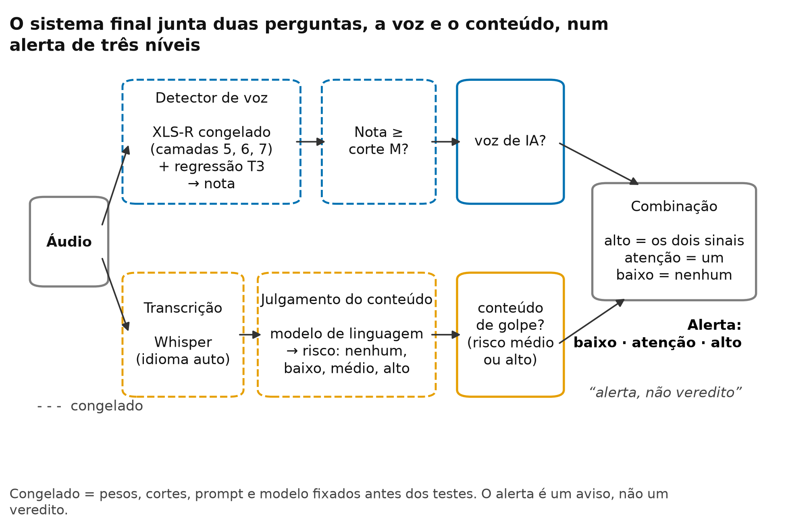

### 4.1 Preparação do áudio

Cada áudio é convertido para mono, 16 kHz. O silêncio das bordas é cortado (quadros 35 dB abaixo do mais forte); se sobrar menos de 0,5 s, o áudio é usado sem corte. Usamos no máximo 8 s do meio, sem completar com zeros, e o clipe é normalizado (média 0, variância 1).

### 4.2 Detector de voz (T3)

O XLS-R 300M fica **congelado**: nenhum peso dele é treinado. Para cada áudio, tiramos a média no tempo das saídas das camadas 5, 6 e 7 (1.024 números cada) e juntamos tudo num vetor **x** com 3.072 números. Esse vetor é padronizado com a média e o desvio do treino, e uma regressão logística dá a nota:

> nota = ((**x** − μ) / σ) · **w** + b

A nota é um logit: quanto maior, mais parecida com voz de IA. Usamos C = 0,01, classes balanceadas e o solver lbfgs. Acima de um **corte** escolhido na validação (a regra M, 0,233), o áudio é chamado de IA. A regressão da T3 foi treinada com 81.288 áudios:

- **estúdio** (20.000 reais e 20.000 de IA, os mesmos da v4);
- **internet real do ML-ITW** (7.802 reais e 2.854 de IA, separados por locutor);
- **IA moderna em canal degradado do RADAR** (15.316 + 15.316, em chinês e japonês, pareados por duração).

O In-the-Wild e todo o português nunca entram no treino.

### 4.3 Ajuste fino parcial (v8, experimento)

Para testar se ajustar o próprio XLS-R ajuda, cortamos o modelo depois da camada 7 e deixamos treinar as camadas 5, 6 e 7 e uma cabeça linear (37,8 milhões de parâmetros), com a cabeça começando nos pesos da T3. Usamos AdamW (taxa 1e-5 nas camadas e 1e-4 na cabeça), 2 épocas de 20.000 clipes balanceados e as sementes 42 e 123. Três controles completam a comparação: R0 (a T3 sem ajuste), R2 (só a camada 7) e R3 (cabeça aleatória).

### 4.4 Modelo leve

Para o aplicativo, cortamos o XLS-R depois da 7ª camada. As camadas 8 a 24 não influenciam a nota, então ela fica idêntica à do modelo completo. Também medimos uma variante em fp16 (placa de vídeo) e uma em int8 (processador).

### 4.5 Módulo de contexto

O áudio é transcrito pelo Whisper large-v3-turbo, com o idioma detectado automaticamente. Trechos com cara de silêncio ou alucinação são descartados. Em seguida, um modelo de linguagem (gpt-oss-120b, temperatura 0) recebe a transcrição entre delimitadores, como dado não confiável, e devolve em JSON:

- um risco: nenhum, baixo, médio ou alto;
- uma lista fechada de sinais (urgência, pedido de dinheiro, código, falsa identidade, troca de número, pedido de segredo e outros), cada um com a evidência copiada do texto.

Uma etapa de validação descarta as evidências que não existem no texto. Se algo falha, o risco vira "indeterminado", e nunca "nenhum".

### 4.6 Combinação

A regra foi fixada antes do teste combinado. A voz conta como IA quando a nota é maior ou igual ao corte M; o conteúdo conta como suspeito quando o risco é médio ou alto. O alerta é **alto** com os dois sinais, **atenção** com um e **baixo** com nenhum. O conteúdo "indeterminado" nunca rebaixa o alerta da voz.

## 5. Experimentos e resultados

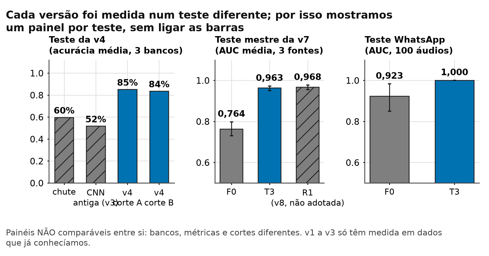

### 5.1 v1 a v3: CNN treinada do zero

Uma CNN pequena sobre log-mel (v1) teve EER de 1,3% na validação, mas AUC de **0,211** no In-the-Wild: ordenava as vozes de internet ao contrário. A hipótese é que ela aprendeu "gravação limpa = real". Aumentar os dados com ruído, banda de 8 kHz e μ-law (v2) e mudar o preenchimento de áudios curtos (v3) não resolveram. Na v3, só trocar a semente movia a AUC do dev_shift de 0,146 a 0,378, uma variação maior que o efeito de qualquer mudança testada.

### 5.2 v4: modelo auto-supervisionado congelado

Com o XLS-R congelado e a regressão logística, o In-the-Wild foi a **0,979** e o dev_shift a 0,983. A acurácia média nos três bancos principais foi 0,851, contra 0,597 do chute da classe mais comum. Usar só a última camada (S1) deu quase o mesmo (0,986 no In-the-Wild): o ganho vem do modelo pré-treinado, e a vantagem da nossa escolha de camadas não foi demonstrada. O ponto fraco foi o português: 0,842 de AUC no BRSpeech-DF e 16,7% dos reais do CORAA acusados.

### 5.3 v5 e v6: alternativas mais complexas

O WavLM Large no lugar do XLS-R (v5) foi pior nos cinco bancos de teste, sobretudo em português (BRSpeech-DF 0,768 contra 0,842). Na v6, um "funil" testou fusão de modelos, MLP, CNN e outros ajustes, escolhendo pela pior fonte da validação. O sistema escolhido foi pior que a v4 no teste (acurácia média 0,829 contra 0,851). Mais clipes também não ajudaram: o dev_shift foi 0,993 com 2 mil clipes e 0,983 com 40 mil. A v4 (chamada F0) continuou como modelo do projeto.

### 5.4 Avaliação externa do F0

Avaliamos o F0, sem nenhuma mudança e uma única vez, em dois bancos novos. A AUC caiu para **0,721** no RADAR (IA comercial com canal degradado) e para **0,689** no ML-ITW (vídeos de redes sociais), contra 0,979 nas entrevistas do In-the-Wild. Parear a duração de reais e falsos não mudou o RADAR (0,720). Com o corte B, 75% dos falsos do RADAR e 85% dos do ML-ITW passaram como reais.

### 5.5 v7: retreinar a regressão com o tipo de áudio em que o detector falhava

Na v7, separamos os dois bancos novos por locutor (ML-ITW) e por idioma (RADAR) e fixamos um **teste mestre** de 52.048 clipes: ML-ITW, In-the-Wild e RADAR em inglês. Comparamos cinco receitas de treino, todas com o mesmo XLS-R e as mesmas camadas:

- **T0** = F0;
- **T1** = + internet real;
- **T2** = + IA em canal ruim;
- **T3** = + os dois;
- **T4** = T3 com peso igual por fonte.

A validação escolheu a T3 (média da AUC por fonte 0,975; T0 0,904, T1 0,945, T2 0,963, T4 0,973). A escolha foi gravada antes do teste.

| fonte do teste mestre | F0 (T0) | T3 | diferença |
|:--|--:|--:|--:|
| ML-ITW | 0,588 | 0,939 | +0,351 |
| RADAR (inglês) | 0,724 | 0,964 | +0,240 |
| In-the-Wild | 0,979 | 0,986 | +0,007 |
| **média** | **0,764** | **0,963** | **+0,200** [+0,168; +0,232] |

*Tabela 2. AUC no teste mestre (IC95 pareado entre colchetes).*

O ganho aparece onde o **tipo** de áudio foi visto no treino. No In-the-Wild, nunca visto, os intervalos se sobrepõem. O RADAR em inglês mede **idioma novo, não gerador novo**: geradores e canal são os mesmos do treino. Há também um sinal de transferência: a T1, que nunca viu o RADAR, subiu o RADAR en de 0,724 para 0,810, e a T2, que nunca viu internet real, subiu o ML-ITW de 0,588 para 0,882. Nos testes antigos de estúdio, a maior queda foi de −0,003. O LlamaPartialSpoof foi de 0,925 para 0,942, e o BRSpeech-DF de 0,842 para 0,956.

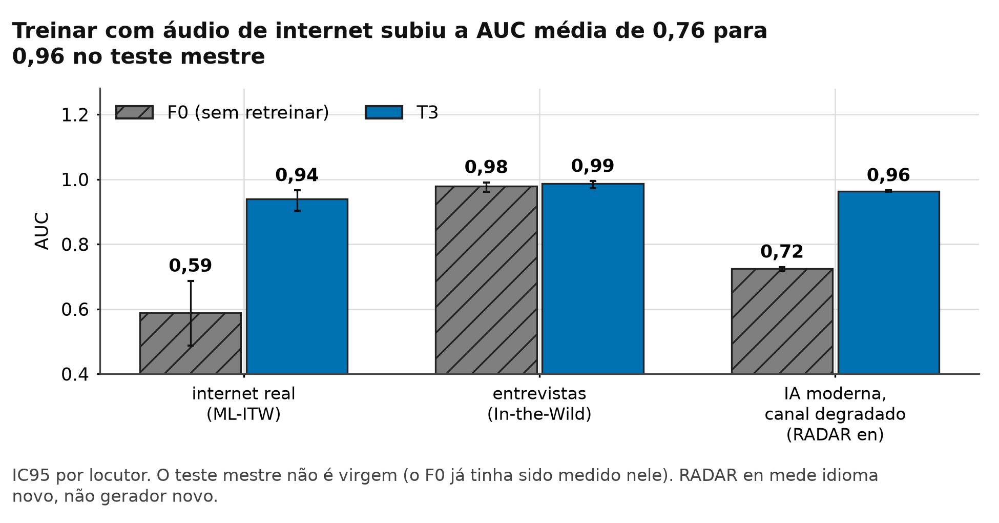

**O corte não se transfere.** A AUC mede a ordem das notas, mas o alerta depende do corte. Com a mesma regra M, a T3 acusa 5,8% dos reais do ML-ITW, 15,6% do In-the-Wild, 14,0% do RADAR en, 11,1% do CORAA e **75,3% do BRSpeech-DF** (português de audiolivro), apesar da AUC de 0,956 nesse banco. Um corte calibrado para português ainda não existe.

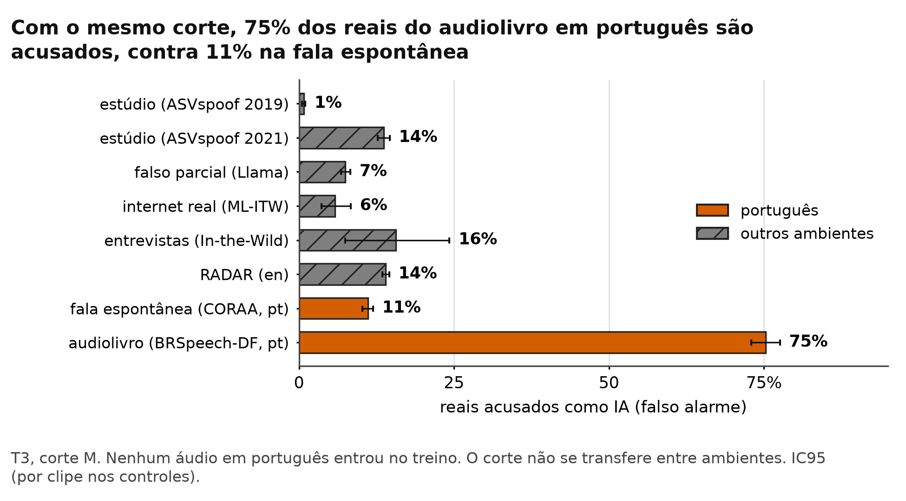

### 5.6 v8: ajuste fino das camadas do XLS-R

Pela regra do protocolo, a validação escolheu a R1 (0,9758 contra 0,9750 da T3). No teste mestre, a média foi de 0,9631 para 0,9671 (semente 42) e 0,9680 (semente 123). As diferenças pareadas foram +0,0040 [+0,0025; +0,0056] e +0,0049 [+0,0030; +0,0071]. A R2 (só a camada 7) ganhou +0,0023, e a R3 (cabeça aleatória) **perdeu** 0,0072, o que mostra o valor de começar a cabeça na T3.

O grupo decidiu **não adotar** a R1, por quatro motivos:

- o ganho é pequeno, e só há 2 sementes;
- o corte da validação foi instável entre as sementes (0,713 e −0,024 de logit);
- os pesos têm 72 MB por semente, contra 3.073 números da T3;
- o corte em português não melhorou de forma confiável (74,2% e 81,5% dos reais do BRSpeech-DF acusados).

A decisão foi tomada depois do teste e está registrada como tal.

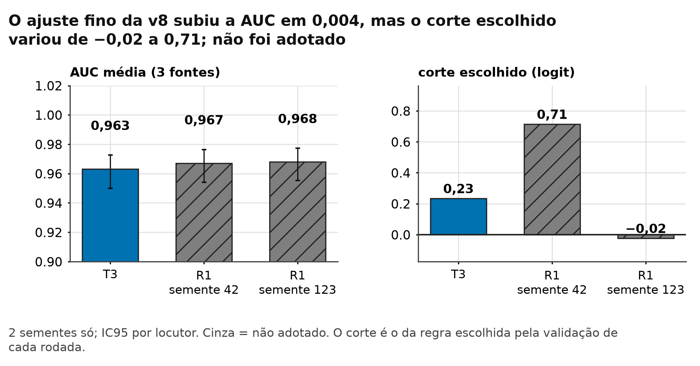

### 5.7 Modelo leve

Cortar o XLS-R depois da 7ª camada deixou o modelo **3,1 vezes menor** (1.211 MB para 386 MB), com a nota idêntica à do modelo completo. Para um áudio de 8 s, a resposta levou cerca de 0,85 s no processador do notebook (4 threads) e cerca de 30 ms na placa de vídeo. A variante int8 é mais rápida, mas muda a nota em até 4,5 logit, e o corte da T3 não vale para ela.

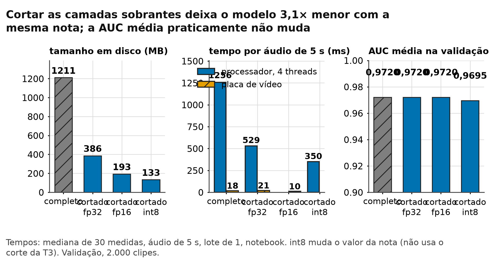

### 5.8 Teste externo com áudios de WhatsApp

O grupo coletou 44 áudios reais de WhatsApp, de 23 pessoas, e gerou 56 clones das mesmas vozes com o Chatterbox. Os clones têm dois tipos de roteiro: pedidos de dinheiro e assuntos do dia a dia. O protocolo foi escrito antes das notas, e o teste rodou uma única vez.

| detector (corte) | acurácia [IC95] | acur. balanceada | detecção de IA | falso alarme | AUC |
|:--|--:|--:|--:|--:|--:|
| **T3 (M)** | **98%** [93,6; 100] | 97,7% | 100% | 4,5% | 1,000 |
| T3 (M), clones recodificados em Opus | 97% | 96,8% | 98,2% | 4,5% | 0,998 |
| F0 (corte A) | 87% | 86,4% | 91,1% | 18,2% | 0,923 |
| F0 (corte B) | 58% | 62,0% | 28,6% | 4,5% | 0,923 |

*Tabela 3. Teste WhatsApp (100 áudios; acurácia trivial 56%).*

O resultado precisa de uma ressalva forte. **Um classificador só com metadados** (duração, taxa de amostragem, banda) também separa os dois grupos: AUC 1,00 com a taxa original e 0,987 sem ela. Os reais vêm do WhatsApp (48 kHz) e os clones saem do gerador a 24 kHz. Por isso, **não dá para afirmar que o detector ouviu só a voz**. Além disso, há um único gerador e só 23 pessoas.

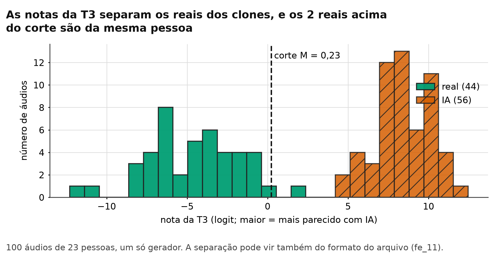

### 5.9 Teste de estresse com um gerador de outra família

Três áudios de um modelo fala-para-fala recente (Dessa), fora do treino, foram avaliados de forma informal, sem protocolo prévio. A T3 acusou **1 de 3**: os outros dois tiveram notas −0,60 e −3,38, abaixo do corte. Três áudios não permitem estimar uma taxa, mas confirmam o limite declarado: o detector não generaliza de forma garantida para famílias de geradores que nunca viu.

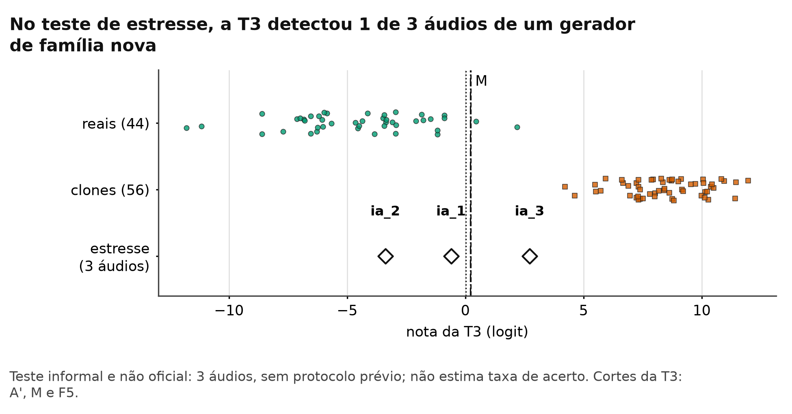

### 5.10 Módulo de contexto

**Textos inventados.** Avaliamos só a etapa de texto em 170 textos em português (40 de desenvolvimento e 130 de teste), com o protocolo congelado antes do teste. No teste, o módulo teve acurácia de 92,2%, pegou **87,7%** dos golpes (IC95 77% a 94%; 95% dos explícitos e 80% dos escondidos) e deu falso alarme em 3,4% das mensagens normais (IC95 1% a 12%). Os 7 golpes com tentativa de injeção de instruções mantiveram o alerta.

**Áudios de WhatsApp.** Um erro de configuração forçou o idioma da transcrição para português, mas os áudios são em inglês. Registramos a errata, escolhemos o modo automático numa parte de desenvolvimento e avaliamos uma única vez na parte reservada (15 pessoas): acurácia de 45% (trivial 82%), recall de 37% e falso alarme de 18%. Corrigir o idioma não mudou o resultado de forma demonstrável.

A análise por roteiro explica o recall baixo:

- todos os roteiros com sinais claros de golpe (número novo, urgência, cartão recusado em viagem, "pague por mim") foram pegos: **26 de 26**;
- nenhum pedido leve de dinheiro entre conhecidos (mercado, jantar, conta de luz) foi pego: **0 de 20**, e parte deles talvez nem seja golpe;
- nenhum assunto do dia a dia gerou alerta: 0 de 10.

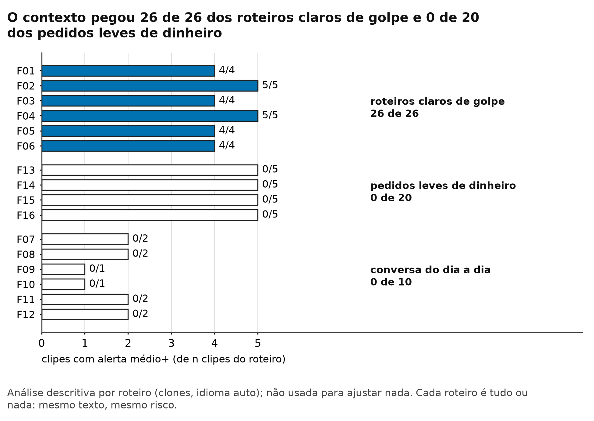

### 5.11 Combinação

Com a regra da Seção 4.6, nenhum áudio de IA da coleta ficou no nível "baixo" (a voz sozinha já os marca), e nenhum áudio real chegou a "alto". Os 46 clones com pedido de dinheiro ficaram 26 em "alto" e 20 em "atenção". Os 17 reais sem golpe ficaram 11 em "baixo" e 6 em "atenção".

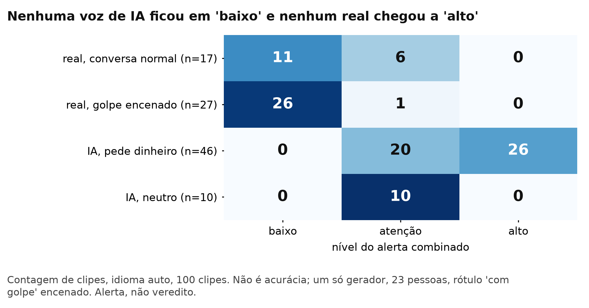

## 6. Protótipo: o aplicativo Escuta Segura

Para mostrar o uso, construímos um esboço de aplicativo. A pessoa envia um áudio recebido, e um servidor local executa o caminho completo: voz (T3), transcrição, contexto e alerta. O resultado aparece numa tela de celular com:

- o veredito;
- o motivo, separado em voz (nota e corte) e conteúdo (risco e sinais);
- a transcrição, com os trechos suspeitos destacados.

A Figura 11 mostra os quatro casos da regra com áudios da coleta do grupo. Os três primeiros passaram por um filtro que simula o canal de telefone fixo (G.711).

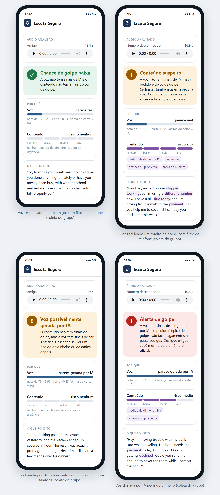

O aplicativo é um protótipo. No modo usado nas telas, o conteúdo é julgado por palavras-chave sobre a transcrição, uma reserva para funcionar sem internet; o módulo de contexto completo (Seção 4.5) é usado quando há acesso à API. Os áudios enviados ficam só no computador que roda o servidor.

## 7. Discussão e limitações

**O que os números sustentam.** Um modelo de fala auto-supervisionado congelado, com uma regressão simples por cima, resolveu a inversão das vozes de internet que a CNN apresentava. Retreinar só a regressão com o tipo de áudio em que o detector falhava levou a grandes ganhos nesse tipo de áudio, sem piorar os testes antigos. Modelos mais complexos (WavLM, funil, ajuste fino) não superaram essa receita de forma convincente.

**O que eles não sustentam.**

- **O teste mestre não é virgem.** O F0 já tinha sido avaliado nesses bancos antes de a v7 ser desenhada.
- **Idioma novo não é gerador novo.** No teste de estresse, um gerador de outra família passou em 2 de 3 áudios.
- **O corte não se transfere entre ambientes.** Com o mesmo corte, a fração de reais acusados vai de cerca de 1% no ASVspoof a 75% no português de audiolivro.
- **O teste de WhatsApp tem um atalho de metadados**, um único gerador e poucas pessoas.
- **Nada foi medido em ligações telefônicas reais.**
- **O contexto foi avaliado com textos inventados** e com roteiros encenados. O rótulo "golpe" dos reais da coleta vem da própria coleta.

**Ética e privacidade.** Os clones foram gerados a partir de gravações enviadas ao grupo **[confirmar: todas com consentimento explícito para a clonagem]** e não são publicados; no repositório, as pessoas aparecem só por códigos (p001 a p023). O módulo de contexto envia áudio e texto a um serviço externo, o que exige consentimento de quem gravou. Num produto, o ideal seria processar no próprio aparelho. O sistema dá **um alerta, não um veredito**: os dois módulos erram, e um golpe pode vir com voz humana.

## 8. Conclusão e trabalhos futuros

Mostramos que um detector simples, construído sobre um modelo de fala auto-supervisionado congelado, generaliza muito melhor que uma CNN treinada do zero. Também mostramos que incluir no treino uma parte do tipo de áudio em que ele falhava levou a média da AUC no teste mestre de 0,764 para 0,963. Junto com um módulo que julga o conteúdo, ele forma um alerta de golpe em três níveis, demonstrado num protótipo de aplicativo.

Os próximos passos são:

1. avaliar o sistema em vários geradores comerciais e em ligações reais, com protocolo escrito antes;
2. calibrar o corte por ambiente, inclusive para português, só pela validação;
3. repetir o ajuste fino com 3 ou mais sementes;
4. remover o atalho de metadados das coletas próprias (mesma taxa e mesmo canal para reais e clones);
5. rodar a transcrição e a classificação no próprio aparelho.

## Referências

[1] X. Wang et al. ASVspoof 2019: A large-scale public database of synthesized, converted and replayed speech. *Computer Speech & Language*, 64, 2020.

[2] X. Liu et al. ASVspoof 2021: Towards spoofed and deepfake speech detection in the wild. *IEEE/ACM Transactions on Audio, Speech, and Language Processing*, 31, 2023.

[3] N. M. Müller, P. Czempin, F. Dieckmann, A. Froghyar e K. Böttinger. Does audio deepfake detection generalize? In *Interspeech*, 2022.

[4] A. Baevski, H. Zhou, A. Mohamed e M. Auli. wav2vec 2.0: A framework for self-supervised learning of speech representations. In *NeurIPS*, 2020.

[5] A. Babu et al. XLS-R: Self-supervised cross-lingual speech representation learning at scale. In *Interspeech*, 2022.

[6] S. Chen et al. WavLM: Large-scale self-supervised pre-training for full stack speech processing. *IEEE Journal of Selected Topics in Signal Processing*, 16(6), 2022.

[7] H. Tak, M. Todisco, X. Wang, J. Jung, J. Yamagishi e N. Evans. Automatic speaker verification spoofing and deepfake detection using wav2vec 2.0 and data augmentation. In *Odyssey: The Speaker and Language Recognition Workshop*, 2022.

[8] A. Krizhevsky, I. Sutskever e G. E. Hinton. ImageNet classification with deep convolutional neural networks. In *NeurIPS*, 2012.

[9] A. Vaswani et al. Attention is all you need. In *NeurIPS*, 2017.

[10] A. Radford, J. W. Kim, T. Xu, G. Brockman, C. McLeavey e I. Sutskever. Robust speech recognition via large-scale weak supervision. In *ICML*, 2023.

[11] OpenAI. gpt-oss-120b & gpt-oss-20b model card. 2025.

[12] V. Panayotov, G. Chen, D. Povey e S. Khudanpur. LibriSpeech: An ASR corpus based on public domain audio books. In *ICASSP*, 2015.

[13] A. Candido Junior et al. CORAA ASR: A large corpus of spontaneous and prepared speech manually validated for speech recognition in Brazilian Portuguese. *Language Resources and Evaluation*, 57, 2023.

[14] RADAR 2026 (avaliação). Zenodo, DOI 10.5281/zenodo.22110815; artigo: arXiv:2605.09568, 2026.

Bancos citados só pelo endereço, como estão em `docs/datasets.yaml`: DFADD (huggingface.co/datasets/isjwdu/DFADD), ShiftySpeech (huggingface.co/datasets/ash56/ShiftySpeech), CodecFake+ (huggingface.co/datasets/CodecFake/CodecFake_Plus_Dataset), LlamaPartialSpoof (github.com/hieuthi/LlamaPartialSpoof), BRSpeech-DF (huggingface.co/datasets/AKCIT-Deepfake/BRSpeech-DF), ML-ITW (huggingface.co/datasets/nccm2p2/ML-ITW). Gerador dos clones: Chatterbox (Resemble AI). Teste de estresse: Dessa (block.xyz/dessa).

## Apêndice A. Todas as versões

| versão | o que mudou | resultado principal | situação |
|:--|:--|:--|:--|
| v1 | CNN em log-mel | In-the-Wild AUC 0,211 (invertido) | descartada |
| v2 | aumento de dados (volume, ruído, canal) | In-the-Wild 0,26 a 0,35 | descartada |
| v3 | preenchimento de áudio curto, 3 sementes | dev_shift 0,146 a 0,378 entre sementes | descartada |
| v4 (F0) | XLS-R congelado (camadas 5 a 7) + regressão | In-the-Wild 0,979; BRSpeech-DF 0,842 | substituída pela v7 |
| v5 | WavLM no lugar do XLS-R | pior nos 5 bancos (BRSpeech-DF 0,768) | descartada |
| v6 | funil (fusão, MLP, CNN, ajustes) | acurácia média 0,829 × 0,851 da v4 | descartada |
| **v7 (T3)** | regressão retreinada com ML-ITW e RADAR | teste mestre 0,764 → **0,963** | **sistema principal** |
| v8 (R1) | ajuste fino das camadas 5 a 7 | teste mestre 0,968 (+0,004 a +0,005) | não adotada |

*Detalhes, datas, protocolos e notebooks de cada versão: `docs/HISTORICO_VERSOES.md`.*

## Apêndice B. Reprodutibilidade e ferramentas

Todo o código, os protocolos, as tabelas de resultado e as figuras estão no repositório do projeto. Os números deste texto vêm de `results/` e `docs/`. Os pesos da T3 (`results/v7_t3_coeficientes.npz`) estão no próprio repositório; os da v8, numa release do GitHub. Ferramentas que vão além do conteúdo da trilha da Liga:

- o XLS-R e o WavLM (via Hugging Face Transformers);
- o Whisper e o modelo de linguagem do contexto (via API do Groq);
- o ajuste fino com precisão mista;
- o formato safetensors;
- o servidor e as telas do protótipo (HTML/JavaScript).
